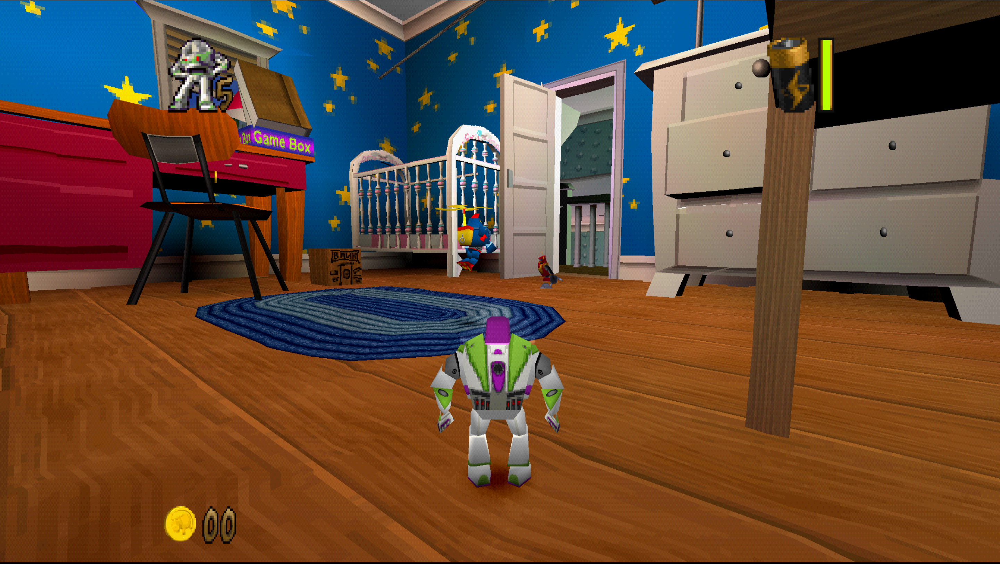

# ToyStory2Recomp

**Relive the PlayStation classic. Recompiled for modern systems.**

*Toy Story 2: Buzz Lightyear to the Rescue!* (PlayStation, 1999), statically
recompiled into a native executable for Windows, Linux and macOS, with
optional enhancements.

<!-- retcomm-readme-metrics -->
[](https://github.com/PeriBluGaming/ToyStory2Recomp/releases)
[](https://github.com/PeriBluGaming/ToyStory2Recomp/releases/latest)
[](https://github.com/PeriBluGaming/ToyStory2Recomp/releases/latest)
<!-- /retcomm-readme-metrics -->



<sub>Screenshot of the original game running in ToyStory2Recomp. Game content
belongs to its rights holders and is not covered by this project's
license.</sub>

## Highlights

- **True 16:9 widescreen**: the 3D view is rendered wide, not stretched.
- **Modern Camera**: orbit and tilt around Buzz with the right stick; R3
  smoothly recenters behind him. *(Coming in v0.5.0; not in v0.4.0.)*
- **Configurable camera**: separate turn and tilt sensitivity, adjustable
  deadzone and independent axis inversion.
- **Skip Startup Intro**: straight to the *Press Start* screen.

All enhancements are optional and can be switched on in the launcher.

> [!IMPORTANT]
> **You need your own copy of the game.** ToyStory2Recomp contains no disc
> image and no retail BIOS. You supply a disc image of the USA release
> (SLUS-00893).

## About

ToyStory2Recomp translates the game's original PlayStation code into C ahead
of time and compiles it into a native program. It is built on
[psxrecomp](https://github.com/mstan/psxrecomp), which provides the
recompiler and the runtime that stands in for the PlayStation hardware, and
[recomp-ui](https://github.com/RetroPortingToolKit/recomp-ui), which provides
the launcher. Game data is read from your own disc image.

| | |
|---|---|
| Game | Toy Story 2: Buzz Lightyear to the Rescue! |
| Region / serial | USA · SLUS-00893 |
| Developer / publisher | Traveller's Tales / Activision |
| Original release | 1999, PlayStation |
| Players | 1 |

## Features

All enhancements are optional and off by default, except for a hidden
compatibility fix. Details and options: [Enhancements](docs/enhancements.md).

| Enhancement | What it does | Available in |
|---|---|---|
| **16:9 Widescreen** | Renders the 3D view natively wide instead of stretching it, anchors the HUD to the screen edges and extends the Level Select frame. The original 4:3 mode stays available. | v0.4.0 and later |
| **Skip Startup Intro** | Skips the legal screens, ESRB screen and startup movies and goes straight to the *Press Start* screen. | v0.4.0 and later |
| **Modern Camera** | Orbit and tilt the camera around Buzz with the right stick; the angle is kept until L2/R2 hand it back to the original Camera Mode. R3 recenters behind Buzz. | v0.5.0 (upcoming) |
| **BIOS free() Compatibility** | Always-on fix that lets the bundled OpenBIOS play past the Andy's House movie. Not a visual option. | v0.4.0 and later |

> [!NOTE]
> **Modern Camera will ship with v0.5.0, which has not been published yet.**
> The current release, v0.4.0, does not include it. Until v0.5.0 is out,
> Modern Camera is available only when [building from source](docs/building.md).

## Download

Get the latest version from the
[Releases page](https://github.com/PeriBluGaming/ToyStory2Recomp/releases/latest).
The latest published release is **v0.4.0**; **v0.5.0** is in preparation and
not yet available. Each release provides `toystory2-<version>-<platform>.zip`:

| Platform | File suffix | v0.4.0 (published) | v0.5.0 (upcoming) |
|---|---|---|---|
| Windows x64 | `windows-x64` | Runtime-tested | CI verified; runtime testing not confirmed |
| Linux x64 | `linux-x64` | Runtime-tested (Steam Deck) | CI verified; runtime testing not confirmed |
| macOS Intel | `macos-x64` | Runtime-tested | CI verified; **manually tested** on a real Intel Mac with all mods, including Modern Camera |
| macOS Apple Silicon | `macos-arm64` | Built by CI, not runtime-tested | CI verified; runtime testing not confirmed |

*CI verified* means the release zip was built, packaged and its contents
checked automatically. *Manually tested* means the release build was played on
real hardware.

## Quick start

1. Download and unpack the zip for your platform.
2. Start `ToyStory2_Recompiled`.
3. On first run, select your disc image (`.cue`) of the **USA release,
   SLUS-00893**; other regions are not supported. A BIOS is optional: the
   open-source [OpenBIOS](docs/bios.md) is bundled.
4. Optionally enable enhancements in the launcher's mod/enhancement settings.

Recommended: **CD speed 4x or lower** (at 8x, *Exit Level* leaves the screen
black). Widescreen needs the OpenGL renderer, which is the default.

Full instructions: [Installation](docs/installation.md).

## Mods and configuration

Enhancements are mod packages that ship with the game and are switched on and
off in the launcher; they are listed in [Enhancements](docs/enhancements.md)
with all options and defaults. The launcher also lists general enhancements
from the psxrecomp framework, such as *CD Speed* or *PGXP Precision*.
Additional `.psxmod` packages can be installed through the launcher's Mods
manager.

## Optional: Retro Launcher

<!-- Short replacement for the generated retcomm-readme-launcher block; see docs/retro-launcher.md before changing. -->
You can play standalone from the release zip, or manage installs, updates and
disc/BIOS setup with
[Retro Launcher](https://github.com/RetroPortingToolKit/Retro-Launcher), a
separate hub for self-compiling recomps. More in
[Retro Launcher](docs/retro-launcher.md).

## Documentation

| Page | Contents |
|---|---|
| [Installation](docs/installation.md) | Requirements, platforms, first run, recommended settings |
| [Enhancements](docs/enhancements.md) | Every enhancement, its options and defaults |
| [BIOS](docs/bios.md) | OpenBIOS compatibility, retail SCPH-1001 workaround |
| [Known limitations](docs/known-limitations.md) | Tested scope, widescreen caveats, savestates |
| [Building from source](docs/building.md) | Patches, build, regeneration, symbols, releases |
| [Retro Launcher](docs/retro-launcher.md) | Optional launcher integration |

## Known limitations

- Native widescreen is verified in Andy's House and on Level Select; other
  levels may show culling gaps or misplaced HUD elements at the edges.
- Manual runtime testing of v0.5.0 is confirmed only for macOS x64; Windows,
  Linux and macOS ARM64 builds are CI verified. The detailed OpenBIOS
  coverage was performed on macOS x64 with v0.4.0.
- Savestates are tied to the exact build and widescreen setting, so states
  from v0.4.0 may not load in v0.5.0; use the in-game memory card for
  long-term progress.

See [Known limitations](docs/known-limitations.md) for the full list.

## Building from source

These commands build the executable from the recompiled game C that is
already committed in `generated/`; no disc is needed for this step.

```bash
git submodule update --init --recursive
bash tools/apply_psxrecomp_patch.sh
./psxrecomp/tools/ci/build_emitters.sh
cmake -S . -B build-release -G Ninja -DCMAKE_BUILD_TYPE=Release
cmake --build build-release --target psx-runtime
```

The pinned psxrecomp submodule needs two versioned patches, which the script
above applies. The complete development workflow, including regenerating the
game C from your disc, symbols, framework pins and releases, is described in
[Building from source](docs/building.md).

## Credits

- **[PeriBluGaming](https://github.com/PeriBluGaming)**: author and
  maintainer of ToyStory2Recomp, including the widescreen, Modern Camera,
  Skip Startup Intro and OpenBIOS compatibility mods, the psxrecomp patches
  and the release setup.
- **Matthew Stanley**: [psxrecomp](https://github.com/mstan/psxrecomp) and
  [recomp-ui](https://github.com/RetroPortingToolKit/recomp-ui), which this
  project is built on.
- **The PCSX-Redux authors**: [OpenBIOS](https://github.com/grumpycoders/pcsx-redux),
  bundled with releases (MIT).
- The authors of the further components listed in psxrecomp's and recomp-ui's
  third-party notices, which ship in every release under `licenses/`.
- *Toy Story 2: Buzz Lightyear to the Rescue!* was developed by Traveller's
  Tales and published by Activision; the game and its characters belong to
  their respective rights holders.

## License

ToyStory2Recomp's original code, such as the mods in `mods/src/`, their
manifests and `tools/apply_psxrecomp_patch.sh`, is © 2026 PeriBluGaming and
licensed under the [PolyForm Noncommercial License 1.0.0](LICENSE). You may
use, modify and share it for noncommercial purposes, provided the license
terms and its `Required Notice` lines are kept. No license for commercial use
is granted.

This license does **not** cover:

- **The game.** `generated/` and the compiled game in release builds are
  machine-translated from the original game's code, which belongs to its
  rights holders. No license to it is granted here.
- **Game artwork**, including the screenshot above.
- **[psxrecomp](https://github.com/mstan/psxrecomp)** (PolyForm Noncommercial
  1.0.0, © Matthew Stanley), including the files in `patches/` and the project
  files generated from its templates.
- **[recomp-ui](https://github.com/RetroPortingToolKit/recomp-ui)** (MIT,
  © Matthew Stanley) and all other bundled third-party components.

[NOTICE.md](NOTICE.md) lists the terms for every part of the repository.

## Disclaimer

ToyStory2Recomp is an unofficial fan project. It is not affiliated with,
endorsed, sponsored or approved by Disney, Pixar, Activision, Traveller's
Tales or Sony Interactive Entertainment. All names, characters and trademarks
belong to their respective owners. You need your own legally obtained copy of
the game to play.

<!-- retcomm-readme-raid -->
---

<p align="center">
  <sub><b>R.A.I.D. — Retro AI Development</b> · a Discord for AI-assisted retro reverse-engineering, decomp &amp; recomp</sub>
</p>

<p align="center">
  <a href="https://discord.gg/Ad9BwSzctP"></a>
</p>
<!-- /retcomm-readme-raid -->
