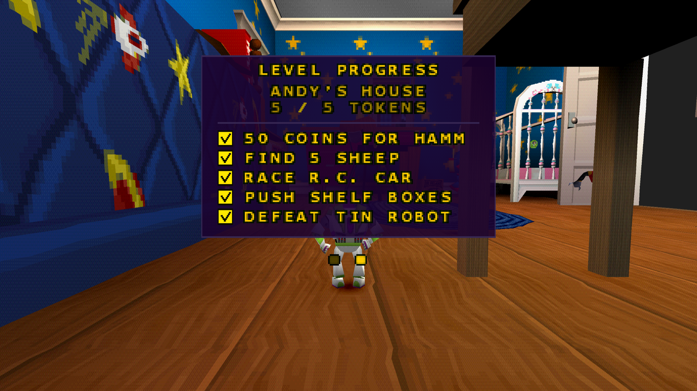
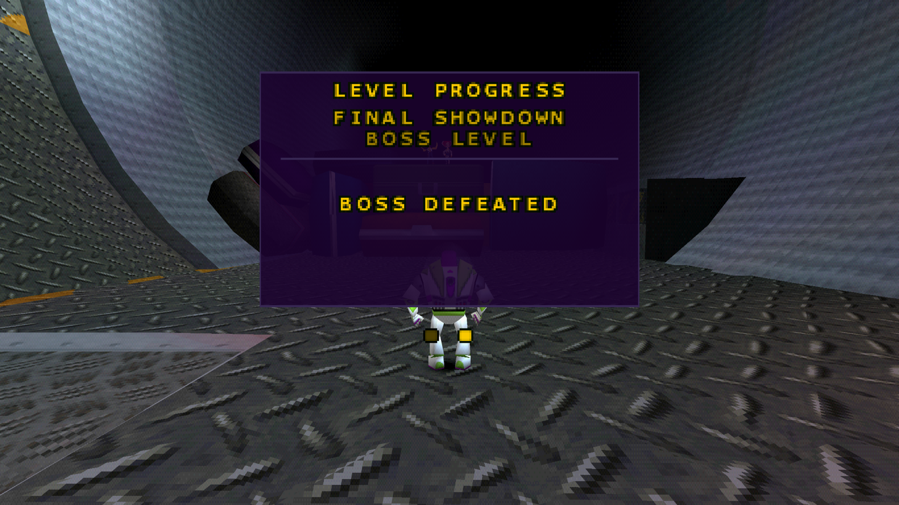
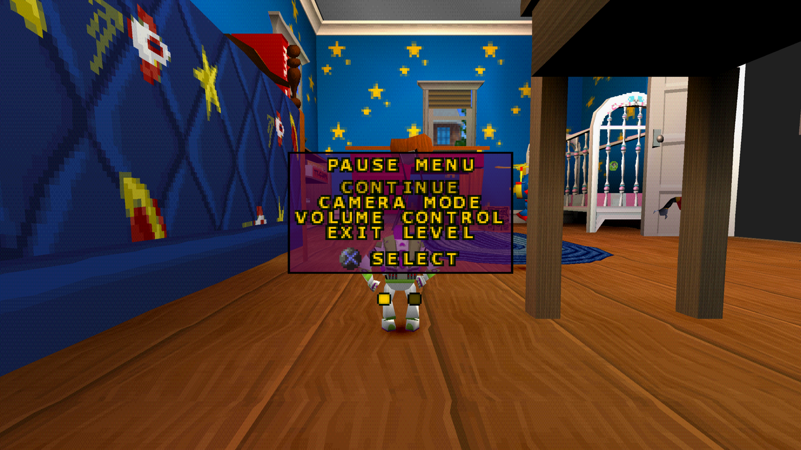

# Enhancements

[← Back to README](../README.md)

ToyStory2Recomp bundles five mod packages. Four are optional enhancements
that are **off by default**; the fifth is an always-on compatibility fix.
Enable the optional ones in the launcher's mod/enhancement settings.

| Enhancement | Default | Available in |
|---|---|---|
| [16:9 Widescreen](#169-widescreen) | Off | v0.4.0 and later |
| [Skip Startup Intro](#skip-startup-intro) | Off | v0.4.0 and later |
| [Modern Camera](#modern-camera) | Off | v0.5.0 and later |
| [Progress Tracker](#progress-tracker) | Off | Next release (not in v0.5.0) |
| [BIOS free() Compatibility](#bios-free-compatibility) | Always on (hidden) | v0.4.0 and later |

The launcher also lists general enhancements that come with the psxrecomp
framework itself, such as *CD Speed*, *Fast Loading*, *PGXP Precision* or
*HD Texture Packs*. They are not specific to this game and are documented by
[psxrecomp](https://github.com/mstan/psxrecomp).

## 16:9 Widescreen

Package `toystory2.enhancement.widescreen` (*Widescreen 16:9*), feature
*16:9 Widescreen*.

- The 3D view is rendered **natively wide** instead of being stretched.
- HUD elements are anchored to the left and right screen edges; the pause menu
  stays centred.
- The Level Select Etch-A-Sketch frame is extended to the full width. Its side
  fillers are reconstructed from the original frame textures.
- When the feature is off, the original 4:3 rendering is unchanged.

Requirements and caveats:

- Needs the OpenGL renderer (the default).
- Use CD speed 4x or lower.
- Verified in Andy's House and on the Level Select screen; other levels have
  not been fully tested. See [Known limitations](known-limitations.md).
- Enabling it reserves a small amount of GPU-DMA memory at start-up, which
  changes the memory layout and can make savestates incompatible between the
  two settings. See [Savestates](known-limitations.md#savestates).

## Skip Startup Intro

Package `toystory2.enhancement.skip-startup-intro`, feature
*Skip Startup Intro*.

Skips the legal screens, the ESRB screen and the startup movies, and goes
straight to the game's original *Press Start* title screen. It uses the
game's own "intro already seen" path, the same one the game takes when the
player skips the legal screens.

For shorter loading you can additionally enable psxrecomp's separate
*CD Speed* enhancement (keep it at 4x or lower, see above).

## Modern Camera

Package `toystory2.enhancement.modern-camera`, feature *Modern Camera*.

> **Availability:** Modern Camera is included starting with
> [v0.5.0](https://github.com/PeriBluGaming/ToyStory2Recomp/releases/tag/v0.5.0).
> It is **not** part of v0.4.0 or earlier releases.

The right analog stick controls the follow camera around Buzz, like in a
modern 3D platformer:

- **Left/right** orbits the camera around Buzz.
- **Up/down** raises or lowers it. By default, stick up looks up (the camera
  moves down).
- The chosen angle is **kept** until you press **L2** or **R2**, which hand the
  camera back to the Camera Mode selected in the pause menu (*Active* or
  *Passive*). L2/R2 keep their original meaning.
- Clicking the right stick (**R3**) swings the camera back behind Buzz with a
  smooth 0.4-second ease-out. Moving the right stick cancels the recenter.
  **Select + R3** remains the Rewind shortcut and never recenters.
- The game's own camera collision, obstacle avoidance and look-at stay in
  charge. Movement stays camera-relative, as in the original.
- Scripted cameras, transitions and the attract demo are not affected.
- After loading a savestate the camera starts with the original behaviour
  until you use the stick or R3 again.

### Options

| Option | Default | Range |
|---|---|---|
| Turn speed (degrees per second) | 120 | 30–360, step 10 |
| Tilt speed (degrees per second) | 60 | 10–180, step 10 |
| Right stick deadzone (%) | 15 | 0–50; applied on top of the controller deadzone |
| Invert horizontal | Off | Swaps the turn direction |
| Invert vertical | Off | Off: stick up looks up. On: stick up moves the camera up |
| R3 Camera Recenter | On | Turn off to disable R3 recentering |

## Progress Tracker

Package `toystory2.enhancement.progress-tracker`, feature
*Progress Tracker*.

> **Availability:** Progress Tracker is not part of v0.5.0 or earlier
> releases. It is planned for the next release.

Adds a second page to the pause menu that shows your Pizza Planet Token
progress for the current level.

- The page shows the **level name**, how many of the level's five tokens you
  have collected (for example `3 / 5 TOKENS`), and one row per token with a
  **checkbox**.
- The five rows describe that level's own objectives, always in the same
  order: Hamm's 50 coins, the lost-items quest, the race or challenge, the
  secret or puzzle token, and the mini-boss. In Andy's House, for example:
  *50 coins for Hamm*, *find 5 sheep*, *race R.C. car*, *push shelf boxes*,
  *defeat Tin Robot*.
- Progress is live: a token shows as collected as soon as you pick it up, even
  before you save to a memory card.
- Boss levels have no tokens. They show **BOSS DEFEATED** once the boss has
  been beaten, and **BOSS NOT DEFEATED** before that.

### Navigation

Two small page dots below the pause menu show which page is active.

| Button | On the original pause menu | On the Level Progress page |
|---|---|---|
| D-pad **Right** | Opens Level Progress | – |
| D-pad **Left** or **Triangle** | Original behaviour | Back to the pause menu |
| **Start** | Continues the game | Continues the game |

- The game stays paused while you switch pages. The original pause menu, its
  cursor and its settings are unchanged.
- **Right** only switches pages on the main pause page. In *Camera Mode* and
  *Volume Control* the D-pad keeps its original function.
- The tracker only reads the game's progress; it never changes it.
- Turning the enhancement off restores the original pause menu without page
  dots. After loading a savestate the pause menu opens on its first page.

Requirements and caveats:

- Works in the original 4:3 mode and with the
  [16:9 Widescreen](#169-widescreen) enhancement; the panel stays centred.
- The page uses the game's own font, so all text is shown in its capital
  letters.
- The objective names are short descriptions written for this enhancement,
  based on the game's own hint texts.
- Tested during a full playthrough of the game, including the final level and
  the ending, together with Widescreen, Modern Camera and Skip Startup Intro.
  Not every combination of settings, controllers and platforms has been
  tested.

## BIOS free() Compatibility

Package `toystory2.enhancement.bios-free-compat`. This is **not** a visual or
gameplay option: it is enabled by default and hidden from the enhancement
list.

It lets the bundled open-source OpenBIOS run Toy Story 2. Without it, the game
shows a black screen after the Andy's House movie on OpenBIOS. The fix
reproduces the retail BIOS behaviour for one specific `free()` call and runs
on any BIOS. [BIOS](bios.md#openbios-compatibility) explains the technical
background and its test coverage.
